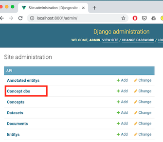
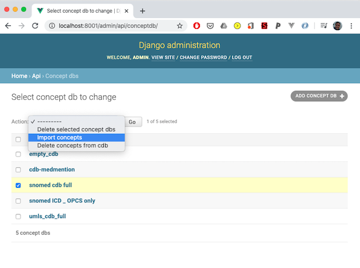
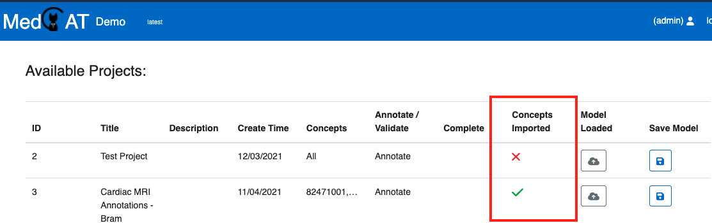
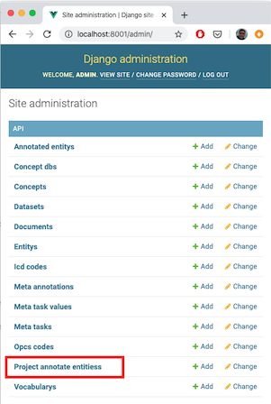
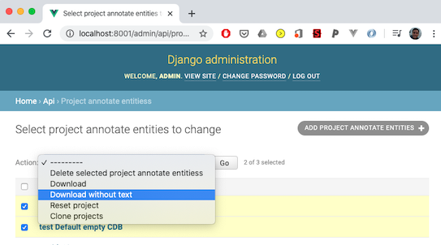

# Django Admin

The **Django Admin** (`/admin`) provides advanced actions and low-level data
management that are not available from the cog icon
([Project Administration](project_admin.md), `/project-admin`).

Use it to edit an existing **project group** and push those settings onto its
projects, to attach projects that were created separately, to set user
passwords, and for the actions below. Creating a project or a new project
group is done from the cog icon.

## Concept lookup index (Solr import)

Concept picker search requires CDB concepts to be imported into Solr.

1. Open `/admin`.
2. Go to **Concept Dbs**.
3. Select one or more CDBs.
4. Run **Import concepts** action.

After import, project list shows whether concepts are indexed for the selected
`cdb_search_filter`.

## Downloading annotations

From Django admin (`/admin` -> **Project annotate entities**), use bulk actions
to export annotations:

- with source text
- without source text
- without source text but with document names

Notebook examples for downstream processing are in:

- `notebook_docs/Processing_Annotations.ipynb`

## Saving and downloading model artifacts

For online-learning projects, admins can save current model state from the
project list. In general, offline retraining from exported annotations is still
recommended for production model releases.

