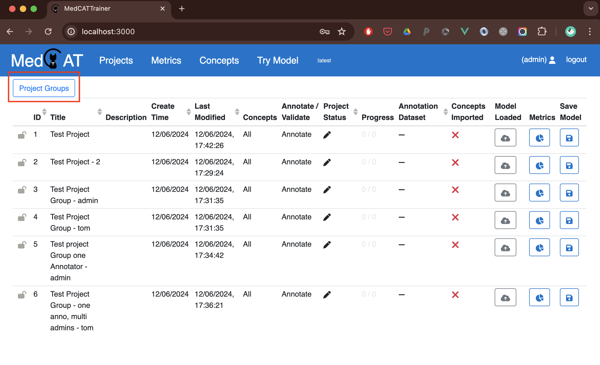
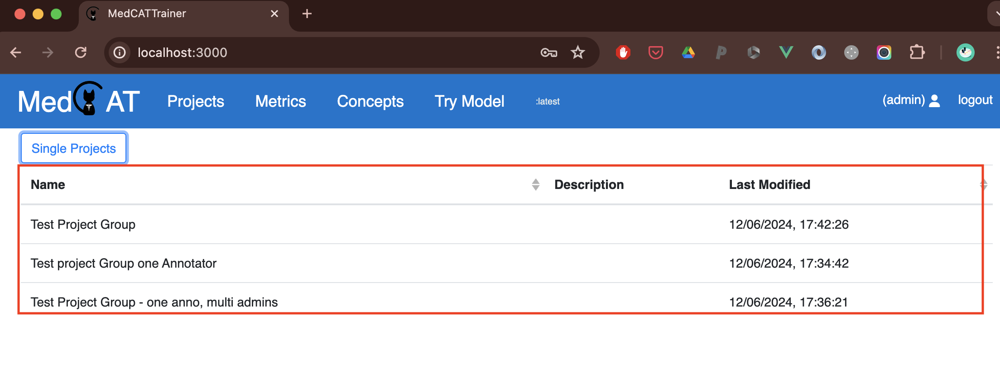

# Annotation Project Groups

A project group is one shared annotation setup applied across several
projects, usually one project per annotator. Groups are how MedCATtrainer
runs double annotation, agreement metrics, and adjudication without cloning
and re-permissioning a template by hand.

Create a group from the cog icon. See
[Create a project group](project_admin.md#create-a-project-group) for the
form fields. This page covers what that save does, and how admins use the
group afterwards.

## When to use a group

Use a group when you need:

- one project per annotator over the same dataset and model,
- one place that records that shared configuration,
- the projects listed together on the home screen.

A single project is enough when only one person is annotating.

Prefer **Project Admin** (`/project-admin`) for day-to-day group creation.

1. Open `/project-admin` and go to the **Projects** tab.
2. Select **+ Create New Project**, then switch the form type to **Project Group**.
3. Configure shared settings (dataset, model, concept filters, tasks, and so on).
4. Under **Group Members**:
   - **Administrators** can see and manage every project in the group (you are added automatically).
   - **Annotators** each receive their own annotation project when associated projects are created.
5. Leave **Create an annotation project for each annotator** checked unless you only want the group shell.
6. Save.

You can still create or edit groups in Django admin (`/admin` -> **Project groups**) when you need low-level control.

### `create_associated_projects = true` (default)

On save, MedCATtrainer automatically creates one
`ProjectAnnotateEntities` per selected annotator.

Its members are the group's administrators, plus that annotator. The person
who saved the group is an administrator even if they were not selected. The
dataset, model, CUI filter, meta tasks, relations, and annotation options are
copied from the group form onto every generated project.

For an agreement study, turn **Train Model on Submit** off on the group form
before saving, so each annotator reviews the same suggestions.

## Saving a group without projects

Clear **Create an annotation project for each annotator** to store the group
and its settings without creating projects. Do this when the projects already
exist and you only need to group them.

Those existing projects are attached from Django admin
(`/admin` -> **Project annotate entities**), by setting each project's group.
The Project Administration screen does not assign an existing project to a
group.

## Changing a group later

The cog screen creates a group. It does not open the group for editing.
Clicking a generated project there edits that one project only.

To change the shared settings and copy them onto the child projects, edit the
group in Django admin (`/admin` -> **Project groups**) and save. Propagation
updates each child project's model, filters, tasks, and annotation options,
and renames each project to `<group name> - <annotator username>`.

Propagation expects the child projects to still match the group's annotators.
If projects were added or removed by hand, save reports that the projects are
out of sync. Edit those projects individually, or recreate the set, instead
of relying on the group save.

## Using groups on the home page

Admins see **Projects** and **Project Groups** tabs on the home page.
Annotators only see their own projects.

**Project Groups** lists each group by name, description, and last modified
time. Last modified follows the most recently changed project in the group.
The list is built from projects you can see, so a group appears once it has
at least one of those projects.

Click a row to open the projects in that group. From there, open a project
to annotate, or use the same admin actions as on the main project list
(prepare documents, concept-import status, model cache, save model, metrics).

## Good practice

- Keep one group per annotator, with one shared dataset and model.
- Turn off **Train Model on Submit** when the goal is agreement between annotators.
- Leave generated names as `<group name> - <annotator username>` so reports stay easy to compare.
- Change shared settings on the group in Django admin, rather than editing each child project differently, while the projects are still in sync.

## Automating with the Python client

`mctclient` can create and list project groups for provisioning scripts and CI.
See [Python Client](client.md).

